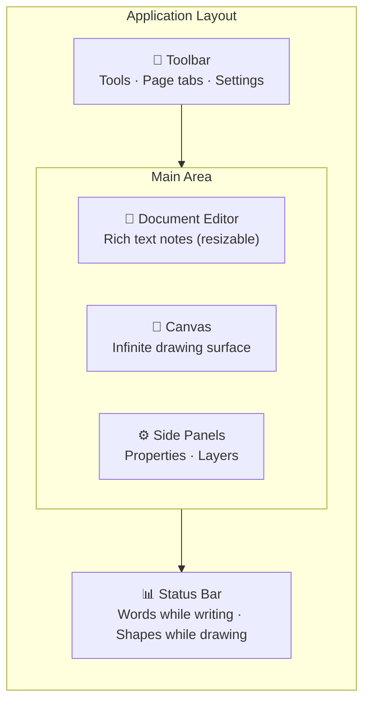

# Interface Tour

Here's a quick overview of everything you see when you open a document in DocuShark.

::: tip Follow along with the real document
This is a real example — <a href="/examples/cell-viability-assay.docushark" download>download it as a <code>.docushark</code></a> and import it to click around as you read, or browse the [Example Gallery](/tutorials/examples).
:::

## Layout Overview

## The Toolbar

The toolbar runs across the top of the screen. From left to right:

- **Tool buttons** — Select, Rectangle, Ellipse, Line, Connector, Text, Hand, and more
- **File import** — Embed files (PDFs, images, spreadsheets) onto your canvas
- **Page tabs** — Switch between pages in your document, or create new ones
- **Layout selector** — Switch the workspace between writing, diagramming, or a split view (see [Layout Modes](/guide/layout-modes))
- **Whiteboard** — Open the sticky-note brainstorming overlay (`Ctrl+I`)
- **Settings** — App configuration, document management, collaboration

## The Canvas

The large central area is your infinite drawing surface. This is where your diagram lives.

- **Pan** by middle-clicking and dragging, or by holding Space and dragging
- **Zoom** with the scroll wheel — it zooms toward your cursor
- **Navigate** with WASD keys (like a game) or arrow keys
- The **grid** helps you align shapes — toggle it in Settings

## Document Editor

The left panel is a full rich text editor powered by Tiptap. Use it to write documentation alongside your diagrams.

- Supports headings, lists, tables, images, LaTeX math, code blocks, citations, and fields
- Each page has its own text content
- Toggle it by clicking the **Document** tab

::: tip
The Document Editor's position and size depend on your active **layout mode** — it
takes center stage in Relaxed and tucks away in Designer. See
[Layout Modes](/guide/layout-modes).
:::

## Property Panel

The right-side panel shows properties for whatever you have selected:

- **Position & size** — X, Y, width, height, rotation
- **Fill & stroke** — Colors, opacity, border style
- **Text** — Font, size, alignment, color
- **Shape-specific settings** — Corner radius, arrow styles, connector routing, etc.

When nothing is selected, the panel is empty.

## Layer Panel

Also on the right side (toggle between Property and Layer panels):

- Shows all shapes in your document in stacking order
- **Drag** shapes to reorder them (front to back)
- **Click** a shape name to select it on the canvas
- Groups show as expandable trees

## Status Bar

The bottom bar describes your document, following whichever part you're working in:

- **While you write:** the page's word count (with text selected, how many of
  those words are selected) and, in a document with several pages, which page
  you're on. Click the count for **Document stats**: words, characters,
  paragraphs and reading time for the page, every page's word count, and the
  canvas's pages and shapes.
- **While you draw:** the number of shapes, how many are selected, and the
  pointer's coordinates in world space.
- **Connection status** when collaborating (🟢 Connected, 🟡 Reconnecting, 🔴 Offline)

With the writing and the canvas side by side, the bar follows the one you last
clicked or typed in. The canvas's zoom controls sit on the canvas itself; see
[Canvas & Navigation](/guide/canvas-navigation).

On a small screen or a touch device the bar keeps only what still applies
there: connection status, and notices such as working inside a group. When
there's nothing to report, it steps aside entirely and returns the space to the
page. On a phone it
also steps aside while the Documents home is open: it describes the editor, not
your library.

## Keyboard Quick Reference

These are the shortcuts you'll use most often:

| Action | Key |
|--------|-----|
| Select tool | `V` |
| Rectangle | `R` |
| Ellipse | `O` |
| Connector | `C` |
| Text | `T` |
| Hand (pan) | `H` |
| Undo / Redo | `Ctrl+Z` / `Ctrl+Shift+Z` |
| Command Palette | `Ctrl+K` |

See the full list in [Keyboard Shortcuts](/guide/keyboard-shortcuts).

## Next Steps

Now that you know the layout, explore the features:

- **[Canvas & Navigation](/guide/canvas-navigation)** — Pan, zoom, WASD, minimap, grid, and snapping
- **[Drawing Tools](/guide/drawing-tools)** — All the tools and shape manipulation
- **[Shape Libraries](/guide/shape-libraries)** — Flowchart, UML, ERD, cloud icons, and custom libraries
